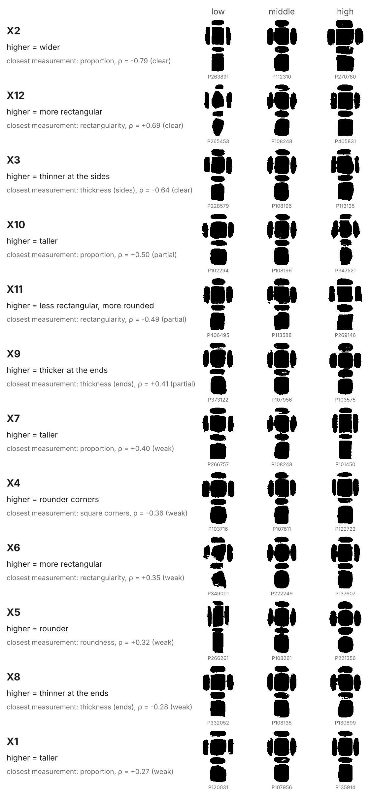

> **Paper:** Section 5 and Conclusions · **Notebook:** `14. Measure tablet features from VAE vectors.ipynb` · **Tables:** `data/vae_measure/`

## What can be measured

Every silhouette with six clean views (76,049 of the 92,876 tablets with a VAE vector) was measured view by view: proportion of the obverse, thickness of the edges against the width, rectangularity, corner squareness and outline regularity. Each measurement was then predicted from the twelve VAE numbers (ridge regression, five-fold cross-validation). Well-preserved tablets are those with an intact obverse outline and obverse and reverse of similar size (47,714).

| Measurement | R² (well preserved) | R² (all) | Use |
|---|---:|---:|---|
| proportion (height ÷ width of the obverse) | 0.82 | 0.72 | reliable |
| thickness at the sides ÷ width | 0.71 | 0.61 | reliable |
| thickness at top and bottom ÷ width | 0.70 | 0.59 | reliable |
| how rectangular the obverse is | 0.51 | 0.54 | partial |
| squareness of the corners (obverse) | 0.46 | 0.45 | partial |
| squareness of the corners (reverse) | 0.44 | 0.44 | partial |
| bulge of the long sides | 0.39 | 0.33 | not recovered |
| bulge of the short sides | 0.37 | 0.30 | not recovered |
| roundness of the outline | 0.22 | 0.14 | not recovered |
| taper (top width ÷ bottom width) | 0.16 | 0.15 | not recovered |
| regularity of the outline (no notches or breaks) | 0.10 | 0.14 | not recovered |
| reverse larger than obverse | 0.03 | 0.05 | not recovered |

*Reliable* features can be read for one tablet; *partial* features serve to compare groups. The CDLI catalogue records thickness for 15% of these tablets and corner shape for none.

## The twelve numbers

{fig-alt="For each VAE number, three CDLI silhouettes at the 10th, 50th and 90th percentile, typical on the other eleven numbers."}

| Number | How to read it | Closest measurement | ρ | Strength |
|---|---|---|---:|---|
| X1 | higher = taller | proportion (height ÷ width of the obverse) | +0.27 | weak |
| X2 | higher = wider | proportion (height ÷ width of the obverse) | -0.79 | clear |
| X3 | higher = thinner at the sides | thickness at the sides ÷ width | -0.64 | clear |
| X4 | higher = rounder corners | squareness of the corners (obverse) | -0.36 | weak |
| X5 | higher = rounder | roundness of the outline | +0.32 | weak |
| X6 | higher = more rectangular | how rectangular the obverse is | +0.35 | weak |
| X7 | higher = taller | proportion (height ÷ width of the obverse) | +0.40 | weak |
| X8 | higher = thinner at the ends | thickness at top and bottom ÷ width | -0.28 | weak |
| X9 | higher = thicker at the ends | thickness at top and bottom ÷ width | +0.41 | partial |
| X10 | higher = taller | proportion (height ÷ width of the obverse) | +0.50 | partial |
| X11 | higher = less rectangular, more rounded | how rectangular the obverse is | -0.49 | partial |
| X12 | higher = more rectangular | how rectangular the obverse is | +0.69 | clear |

## Caveats

* Photographs carry no scale: all measurements are ratios.
* Museum photographic practice differs; compare within a collection or control for it.
* The VAE was trained with the tablet's period as a second target.
* Values read from the VAE are pulled toward the average; use measured values for single tablets.
